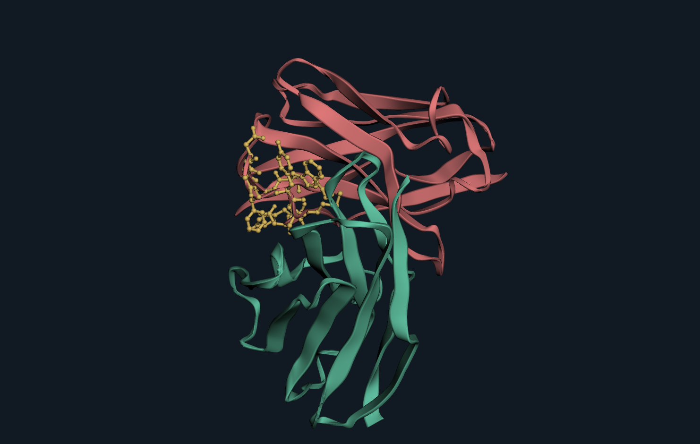

# Antibody Inspection

**Follow an antibody from sequence to structure—and keep the evidence with it.**

Antibody Inspection brings domain maps, numbered sequences, molecular structures and reference populations into one VS Code workspace. Select a CDR, inspect the corresponding residues in 3D, compare a local prediction with experimental coordinates, and save the observation as a portable project.

Your sequences stay on your computer. No account or API key is required.



*Actual application export: locally predicted Herceptin Fv, with heavy-chain CDR3 selected. This image shows a predicted variable-domain model, not the full antibody or an antigen-bound prediction. [Export metadata](docs/media/herceptin-fv.png.json).*

## Try the research workflow

Install the supplied `.vsix` using **Extensions: Install from VSIX** in desktop VS Code. Then run **Antibody Inspection: Explore Guided Demo** from the Command Palette, or select the antibody icon in the Activity Bar.

**The demo works immediately, offline, without Python setup.** It includes deposited Herceptin Fab / HER2 data from [PDB 1N8Z](https://www.rcsb.org/structure/1N8Z), precomputed sequence analysis, a real locally generated Fv prediction and published reference populations.

| Observation | What you can inspect |
| --- | --- |
| Molecular composition | Explicit heavy, light and antigen identities; Fab and Fv sequence ranges |
| Sequence | IMGT positions, insertion codes, CDRs and amino-acid germline reference candidates |
| Experimental structure | The Fab / HER2 complex, linked residue selection and atomic distances |
| Prediction comparison | Framework fitting and CDR3 evaluation, with separate residue sets |
| Surface profile | Local hydrophobic and charged-residue exposure, connected patches and selected-chain scope |
| Reference populations | OASis peptide identity and published TAP2 distributions with fixed denominators |
| Evidence | Source records, calculation conditions, notes and saved observations |

Use **Next observation** to follow the seven-step tour. You can explore any tab freely, return to a tour step, and **Save as** your own project. Read the [five-minute demo guide](docs/demo.md) for the exact observations and their interpretation.

## Bring your own data

1. **Import** FASTA, CSV or TSV, or paste sequences. Original text is preserved. Assign chain roles and construct relationships explicitly.
2. Open **Workspace tools → Analysis runtime**. Install the private runtime or choose an existing compatible Python environment. The tested Windows setup uses Python 3.12; first installation needs internet access.
3. **Analyze collection** to calculate numbering, CDR/FR regions and sequence properties. Antigen records are excluded from antibody numbering.
4. Load PDB or mmCIF coordinates, inspect mapped residues, and record observations. Optional model preparation enables local Fv/VHH prediction.
5. **Save** a portable JSON project with sequences, results, coordinates, references and view state. Export FASTA, an analysis report or a structure image with metadata.

[Full user guide](docs/user-guide.md) · [Scientific definitions and limitations](docs/requirements.md) · [Project format](docs/project-format.md)

## What is available

| Area | Implemented capabilities |
| --- | --- |
| Sequences | FASTA / quoted tables / paste; retained duplicates; explicit nucleotide translation; original-input coordinates |
| Domains | ANARCII IMGT/Kabat numbering; independent CDR definitions and composition; multi-domain offsets; constant-domain reference similarity |
| Comparisons | Numbered alignments, positional counts and entropy; amino-acid V/J reference candidates with coverage and tied-best counts |
| Structures | Bundled 3D viewer; PDB/mmCIF parsing; deposited biological assemblies; conservative sequence mapping; residue selection; distance and contact tables |
| Geometry | SASA and pairwise buried area; source-annotated disulfides; Cα superposition with independent fit/evaluation selections |
| Prediction | Optional local ImmuneBuilder Fv/VHH ensemble and OpenMM refinement; model checksums and calculation provenance |
| Properties | Molecular weight, pI, charge at pH 7.4, GRAVY, sequence motifs and OASis human-reference peptide identity |
| Evidence | Censored measurements, specimen/lot/conditions, sources, notes, pinned ranges and saved observations |

### Scientific scope

This is a research inspection application. Similarity candidates do not establish germline gene assignment or species of origin. Peptide humanness does not predict immunogenicity. Sequence motifs do not establish a chemical reaction rate. Close contacts do not prove binding.

TAP2 reference populations are included; **official candidate TAP scoring is not included**. The extension instead provides an independent, open-source [local surface profile](docs/surface-profile.md). It does not require SAbBox. A reference histogram alone is not a candidate evaluation. Predicted structures cover Fv or VHH only; they do not include antigen, constant domains or linkers. Prediction B-column values represent ensemble coordinate dispersion in Å, not pLDDT.

The original R1 acceptance scope is still in progress, including complete binding-unit connectivity, constant-region EU numbering and offline runtime distribution. [The acceptance matrix](docs/requirements.md) distinguishes implemented, partial and missing functionality. This package is not presented as a completed R1 release.

## Local data, explicit setup

The extension has no telemetry and does not send sequences to an analysis service. The viewer has no external network access. Runtime setup downloads packages; explicit model preparation downloads official weights. After those resources are available, supported analysis runs locally. VS Code and other installed extensions have their own behavior.

Projects are readable JSON, with a 64 MiB file limit. Recovery retains recent unsaved work in VS Code extension storage; saving a project creates a portable file. [Privacy and storage details](docs/privacy.md).

## Development and verification

Use Node.js 24 and Python 3.12:

```sh
npm ci
npm run check
npm test
python -m venv .venv
# Activate the environment, then:
python -m pip install -r worker/requirements.txt
python -m unittest discover -s test -p '*_test.py'
npm run package
npm run test:electron
```

The Windows dependency lock is `worker/requirements-lock-windows-py312.txt`. F5 opens a development host. Electron tests install the packaged VSIX into an isolated VS Code profile; `VSCODE_EXECUTABLE_PATH` selects an existing installation. Model-based validation additionally requires prepared prediction weights.

For reproducible errors, include the extension version, VS Code version, operating system and a minimal public or synthetic input in a [GitHub issue](https://github.com/yktsnd/antibody-inspection/issues). Do not attach confidential sequences or project files to public issues.

## License and sources

Original code is Apache-2.0. Bundled libraries, public reference adaptations and separately installed scientific engines retain their own terms; see [third-party notices](THIRD_PARTY_NOTICES.md). The demo cites Cho et al. (2003), [doi:10.1038/nature01392](https://doi.org/10.1038/nature01392), and preserves source and calculation metadata inside the project. No prediction weights are bundled with the VSIX.
